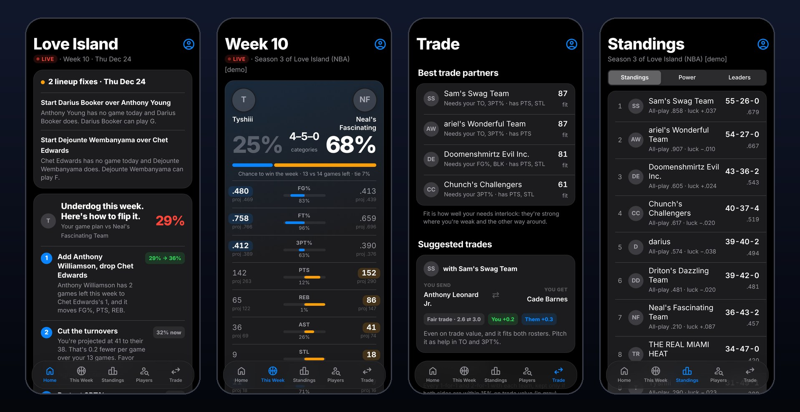

# 🏀 NBA Fantasy Dashboard

[Click here to check it out](https://nba-fantasy-dashboard.onrender.com/)

A phone-first dashboard for **any Yahoo Fantasy Basketball league**. It started as the
companion app for my friends' league, **Season 4 of Love Island (NBA)** (H2H, 8 teams, 9
categories with 3PT%), which still opens without sign-in. Anyone else taps **Sign in with Yahoo**
and picks one of their own leagues, in any scoring format.

It answers the questions we actually ask each other in the group chat: *Am I winning this
week? What should I do about it? Who should I trade with? Who's sleeping on the wire?* Every
number comes from the same simulation model, so a headline never contradicts the odds below it.

> Hosted on Render's free tier. A keep-alive ping keeps it awake, but if it was asleep the first
> load takes up to a minute.

---

## Any Yahoo league

| Format | What works |
|---|---|
| **H2H categories**, any mix (9-cat with 3PT% or 3PTM, 8-cat, 11-cat with A/T, FGM, FTM ...) | Everything |
| **H2H most categories** (one win per week) | Everything; standings count matchups, not categories |
| **H2H points** (the league's own modifiers) | Everything; the matchup is one "FPTS" category |
| **Rotisserie / season points** | Players, trades and Yahoo's standings (no weekly matchups to simulate) |

Categories we can't model yet (double-doubles, triple-doubles, offensive/defensive rebounds,
fouls) are named on screen, and the odds use the league's other categories instead of guessing.

**How it works.** Each league's scoring is read from its Yahoo settings (`stat_categories`,
`stat_modifiers`, `scoring_type`) into a `Scoring` (`fantasy/categories.py`). Every model reads
the *active* scoring from a per-session `ContextVar`, so two people in different leagues on the
site at the same moment never see each other's categories. The matchup model builds its
components from what each league actually reports: a 3PTM league sends made threes but no
attempts, so it models 3PTM directly instead of attempts × percentage. Caches are keyed by
league (plus a scoring fingerprint where the input is shared, like the NBA player table), so
members of the same league share one copy of the Yahoo data.

**Sign in with Yahoo** (`fantasy/auth.py`, `fantasy/accounts.py`)
- OAuth 2.0 authorization-code flow. The `state` is HMAC-signed with a 10-minute expiry, so
  it's checked without server storage and a forged or replayed callback is rejected.
- "Stay signed in": the refresh token is encrypted (Fernet) into a cookie only this server can
  read. Tokens never appear in URLs, logs or error messages, and the sign-in code is scrubbed
  from the address bar immediately.
- You can only open leagues your Yahoo account is in. A shared link to someone else's league
  falls back to your own (or the featured league).
- Read-only: the app never writes to Yahoo.

**Tested** with nine fake leagues in Yahoo's JSON shapes (`fantasy/fake_yahoo.py`): 3PT% and
3PTM 9-cat, 8-cat, 11-cat one-win, 10-cat with double-doubles, H2H points, roto, 6 and 16 teams,
and preseason. Every page renders in every league, and `scripts/load_test.py` opens 18 browsers
at once across all nine. Last run: 36 sessions, 0 problems (no category leaking between leagues,
no errors), peak server memory about 300 MB.

---

## The app

| Tab | What it answers |
|---|---|
| **Home** | Your **game plan**: the top 3 moves for this week, each scored by how much it changes your odds (e.g. *Add X, drop Y: 17% → 26%*). A top story, a headline for every matchup (coin flip, upset watch, comeback, blowout), and the **Wire report**: one good and one bad thing about every team. A lineup alert appears when something needs fixing today. |
| **This Week** | Live win probability, all nine categories with banked totals, projections and odds (bars grow toward whoever is favored), your game plan, **Lineup check**, **Strengths & weaknesses**, and a scout card for your opponent. |
| **Standings** | **Standings** (record, all-play, schedule luck) · **Power** (schedule-neutral strength) · **Leaders**: a teams × categories rank grid, a leaderboard per category with movement arrows, and week-by-week trend charts to compare any 4 teams against the league average. |
| **Players** | **Pickups** weighted toward the categories still in play in your matchup (injured players excluded, game-time decisions flagged) · **Rankings** with punt and stat-window filters, sorted by 9-cat H2H value by default or by Yahoo default fantasy points (volume view, ignores shooting %). |
| **Trade** | **Trade Hub**: best partners by how well your needs interlock, and suggested 1-for-1 / 2-for-1 deals that are fair on overall value *and* help both teams. One tap loads a suggestion into the **builder**, which grades any trade and calls out overpays. |

### Built like a phone app

- Floating frosted tab bar, iOS system colors, follows the phone's light/dark setting.
- **Your team, remembered** in the link (`?team=3`). Add it to your home screen and it opens
  straight to your stuff.
- Team profile pictures from Yahoo; full team names wrap instead of truncating.
- Lists, not spreadsheets. Nothing scrolls sideways; every tap target is at least 44pt.
- An animated loading screen (bounce, scoreboard, or swish, picked at random) on the first load
  of each visit. Pure CSS, so it costs nothing to load.
- Color is never the only signal: every +/− has a sign and every probability has a number.

Everything runs without credentials in **demo mode** on a synthetic league:
`FANTASY_DEMO=1 streamlit run app.py`.

---

## How it works

### 1. Matchup model (`fantasy/matchup_model.py`)

Each team-week is reduced to **per player-game rates** over 12 components (FGA, FG%, FTA, FT%,
3PA, 3P%, PTS, REB, AST, STL, BLK, TO). Working per game separates roster quality from schedule
volume, since Yahoo reports each team's games remaining.

- **Team strength:** a recency-weighted average (6-week half-life) shrunk toward a prior worth 3
  weeks of data. The prior is the team's **current roster projection**, so week 1 and post-trade
  teams are sensible.
- **Randomness is learned, not assumed:** week-to-week swings are pooled across the league into a
  covariance matrix, scaled by games remaining, with correlations kept (a high-volume week lifts
  PTS, threes, FGA *and* turnovers together).
- **Parameter uncertainty** is added on top and shrinks as the season goes on.
- **Percentages are simulated from makes and attempts**, then rounded the way Yahoo displays
  them, so category ties happen at realistic rates.
- Each matchup is played out **4,000 times** from what's already banked.

A walk-forward backtest (`mm.backtest`, in the test suite) predicts every category of every past
matchup using only earlier weeks and reports Brier skill and a reliability curve.

### 2. Player values (`fantasy/valuation.py`)

- z-scores against a **replacement-aware pool** (`teams × roster spots`), not all ~550 players.
- **Weighted for head-to-head** (`h2h_factors`): each category counts by how much it decides
  weekly matchups, measured on the league's own pool. Rankings, Pickups, the game plan and trades
  all share this weighting; per-category z columns stay unweighted. `value_players(..., h2h=False)`
  gives plain 9-cat z.
- Percentages use **impact**: `(player% − pool%) × attempts`.
- Early season blends this season with last: `w = GP / (GP + 15)`.
- Punting removes a category from both the total and pool selection.

### 3. Game plan and storylines (`fantasy/insights.py`)

- **Add/drop moves are re-simulated:** the pickup's expected stats over his remaining games are
  added and the dropped player's removed, using the same random seed, so the difference in odds
  is the move and not noise. Players Yahoo lists as out/injured/IL are never recommended; your own
  injured players count as zero games, which surfaces them as drops (top-60 players never are).
- Also ranked: the most winnable category you trail (with the per-game gap), a lead to protect,
  games-left edges, and lost causes not worth chasing.
- **Headlines** come from templates keyed to the simulation (blowout, in control, tight, coin
  flip, upset watch by standings rank, comeback when trailing but favored), tied to transactions
  when a team just added help in the deciding category.
- **Wire report:** for each team, the strongest positive and negative signal from trades (won or
  lost by per-game value), pickups now ranked highly, scooped drops, regretted cuts, streaks, this
  week's odds, injured players hogging spots, and inactivity, falling back to its best and worst
  category.

### 4. Trades, profiles and lineups (`fantasy/hub.py`, `fantasy/trade.py`)

- **Trade value is not the 9-cat ranking** (`valuation.trade_market`). Plain z-scores ranked
  Giannis #28, behind Dyson Daniels, which let the hub call Giannis + Jabari Smith for Daniels
  fair. Trade value now layers three research-backed adjustments:
  1. **H2H weekly noise** (the "G-score" idea, Rosenof, arXiv:2307.02188): each category is
     shrunk by `1/sqrt(1 + (weekly SD / between-player SD)²)`, measured on the league's own pool.
     On Nov 2026 data: PTS 0.95, REB/AST ~0.89, BLK 0.75, TO 0.73, FT% 0.65, STL 0.61, FG% 0.59,
     3PT% 0.36. One-category specialists stop looking like stars.
  2. **Build-around value:** the better of the 9-cat total and the best single-category punt, at
     95%. That's how managers price Giannis (punt FT%).
  3. **Star premium:** value above replacement raised to the 1.5 power, then packages count the
     second player at 60%. One star beats two good players, especially in an 8-team league with a
     deep waiver wire.
  Result: Giannis is a top-5 trade asset; Giannis + Jabari for Daniels is flagged as a 63% overpay;
  Giannis for Daniels + Maxey is close but still short. These cases are regression tests
  (`tests/test_trade_value.py`) on real per-game stats.
- **Fair first:** a suggested trade must be within **15%** on trade value, and in a 2-for-1 the side
  getting the best player can't also get more than a 5% edge.
- **Then both sides must gain** on their own needs. Categories are weighted by how contested they
  are for that team (`0.5 + 0.5 × 4p(1−p)`), so needs tilt value without erasing a star.
- Ideas are ranked by the **smaller** of the two gains: the most balanced win-win first. Cards and
  the builder share one scoring function, so their numbers always match.
- **Partner fit** is how negatively two teams' category profiles correlate (they're strong where
  you're weak, and vice versa).
- **Strengths & weaknesses** shows two ranks per category: past results (all-play category win
  rate) and current roster (summed per-game z). They can disagree right after a trade, so both
  are shown rather than blended.
- **Lineup check** compares today's lineup slots with today's NBA schedule: injured starters,
  starters with no game while an eligible bench player has one, and IL candidates.

### 5. Leaders (`fantasy/leaders.py`)

This week's live totals or the season's average week; percentages from summed makes ÷ attempts
(as Yahoo scores them); turnovers rank fewest-first and their chart axis is flipped so up always
means better. Trend charts use completed weeks only, so a half-finished week doesn't read as a slump.

### 6. League analytics (`fantasy/power.py`, `fantasy/transactions.py`)

All-play records and **schedule luck**, schedule-neutral power ratings, and add/drop pairing for
the transaction log.

---

## Data pipeline

### Yahoo (live league data)

One OAuth token on the server; every visitor reads from shared caches, so Yahoo traffic depends
on cache refreshes, not on how many people are looking (roughly 100–200 calls/hour at most).

| Data | Refresh |
|---|---|
| Completed weeks | cached for the life of the process |
| Live week | 5 min |
| Rosters and lineups | 10 min |
| Transactions | 15 min |
| Free agents | 30 min |

Access tokens last an hour and refresh automatically into a writable temp copy (Render mounts
`/etc/secrets` read-only). The refresh token is long-lived; it stops working only if the Yahoo
password changes, the app's access is revoked, or Yahoo disables the app.

### NBA stats (snapshots, never live)

NBA blocks cloud servers: stats.nba.com times out and cdn.nba.com returns 403 from both Render and
GitHub Actions. So a page load never calls NBA:

1. `.github/workflows/refresh-data.yml` runs `scripts/refresh_data.py` **every 3 hours**.
2. Per-game stats come from **Basketball-Reference** (one page per season); NBA person ids are
   attached offline from the player list bundled with `nba_api`, which keeps headshots working.
   The schedule comes from **ESPN's public scoreboard**. stats.nba.com is still tried first.
3. "Last 2 weeks" and "Last 30 days" are computed from daily season-total snapshots.
4. CSVs are committed to the **`data` branch** (not `main`, so no Render redeploy) and read from
   raw.githubusercontent.com in about a second (`fantasy/snapshot.py`).
5. `.github/workflows/keep-alive.yml` pings the site every 10 minutes.

To rebuild by hand: **Actions → refresh-nba-data → Run workflow**, or locally
`python scripts/refresh_data.py --out data`.

---

## Running it

```bash
pip install -r requirements-dev.txt
FANTASY_DEMO=1 streamlit run app.py        # no credentials needed
pytest -q                                  # 147 tests, ~2 min
python scripts/load_test.py                # 18 browsers, 9 fake leagues, all at once
```

### Live mode (Yahoo)

1. Create an app at developer.yahoo.com with **Fantasy Sports** permission (Yahoo now approves
   access per app; an app created before approval won't work, so create a new one).
2. Get an authorization code: open
   `https://api.login.yahoo.com/oauth2/request_auth?client_id=<CLIENT_ID>&redirect_uri=<REDIRECT_URI>&response_type=code`,
   **signed in as the Yahoo account that's in the league**, and copy `code=` from the redirect.
3. Exchange it at `https://api.login.yahoo.com/oauth2/get_token` and save the JSON
   (`consumer_key`, `consumer_secret`, `access_token`, `refresh_token`, `token_time`, `token_type`).
4. Provide it via a Render **secret file** `keypair.json` (also read: `oauth2.json`, or the
   `KEYPAIR_JSON` / `YAHOO_OAUTH_JSON` env vars).

Optional: `YAHOO_LEAGUE_ID` (the number in your league URL) pins the league and rolls over each
season; `YAHOO_LEAGUE_KEY` (`478.l.12345`) pins an exact key. If Yahoo can't be reached, the site
falls back to the demo league and says why.

### Sign in with Yahoo (other leagues)

Use a **second** Yahoo app for this, so the featured league's token is never affected:

1. Create an app at developer.yahoo.com with **Fantasy Sports: Read** permission and the
   redirect URI set to the site's URL (`https://nba-fantasy-dashboard.onrender.com/`).
2. In Render, set `YAHOO_CLIENT_ID`, `YAHOO_CLIENT_SECRET`, `YAHOO_REDIRECT_URI` (the same URL)
   and `APP_SECRET` (any long random string; `render.yaml` generates one). Changing
   `APP_SECRET` signs everyone out.
3. `FEATURED_LEAGUE=0` makes every visitor start at the sign-in page instead of Love Island.

Until those are set, the site works exactly as before and the sign-in button stays hidden.

**Render:** `render.yaml` starts `streamlit run app.py --server.port $PORT --server.address 0.0.0.0`
and auto-deploys on pushes to `main`.

### Troubleshooting

| Symptom | Cause |
|---|---|
| `KeyError: 'access_token'` | The secret file has keys but no token. Run steps 2–4. |
| `ELAPSED TIME` in the logs is huge | The app is reading an old token file. Check every secret file. |
| "You are not allowed to view this page because you are not in this league" | The token belongs to a different Yahoo account than the one in the league. Re-authorize signed in as the right one. |
| Player stats empty | The `data` branch hasn't been built yet: run the refresh workflow. |

---

## Project layout

```
app.py                     Streamlit app: tabs, landing page, caching layer, "my team" state
fantasy/
  categories.py            per-league scoring (any categories or points) + active-scoring ContextVar
  auth.py                  Sign in with Yahoo: OAuth, signed state, encrypted remember-me cookie
  accounts.py              which league this session sees: featured, signed-in, or demo
  yahoo_client.py          league discovery, settings -> scoring, pure JSON parsers
  fake_yahoo.py            test-only: whole leagues in every format, in Yahoo's JSON shapes
  data_source.py           live vs. demo switch; reads NBA data from snapshots
  snapshot.py              snapshot reader + Basketball-Reference / ESPN / NBA CDN parsers
  nba_data.py              per-game stats, schedule, season blending, name matching
  matchup_model.py         team-strength model, Monte Carlo simulator, walk-forward backtest
  insights.py              game plans, matchup headlines, wire report
  hub.py                   trade partners and fair trade search, team profiles, lineup check
  leaders.py               category leaderboards and trends
  valuation.py             replacement-aware z-scores, punts
  trade.py                 trade evaluation, shared package scoring, streaming board, injury status
  power.py                 all-play, luck, power ratings
  transactions.py          add/drop pairing, activity
  ui.py                    iOS-style components and light/dark CSS
  splash.py                animated loading screen (3 variants)
  demo.py                  synthetic league generator (tests + demo mode)
scripts/refresh_data.py    builds the NBA snapshots on the data branch
scripts/load_test.py       many browsers x many leagues against a local server (fake_server_app.py)
.github/workflows/         tests, 3-hourly data refresh, keep-alive ping
tests/                     147 tests: parsers, model skill and calibration, valuation, fair trades,
                           every scoring format, sign-in security, thread isolation, every tab
                           in every league
```

---

## Changelog

### Season 4 (2026–27)
- **Any Yahoo league:** Sign in with Yahoo, a league picker, and per-league scoring (any
  category mix, one-win weeks, points, roto). Love Island still opens without sign-in.
- **Speed:** completed weeks, rosters and free agents load in parallel; all-play standings are
  cached (it was 70% of a cached page's CPU).
- **Yahoo access:** moved to a new Fantasy-approved Yahoo app; documented the token flow and the
  wrong-account pitfall.
- **Fast loads:** NBA stats moved off the request path into 3-hourly snapshots; "Loading player
  stats" used to hang for minutes on blocked stats.nba.com calls, then crash on empty data.
- **Scoring fix:** the league scores **3PT%**, not 3PTM. The old assumption blanked every
  counting-stat projection and inflated tie odds (61% on one matchup).
- **New:** Home tab (game plan, headlines, wire report), Trade Hub with fair suggestions, Lineup
  check, Strengths & weaknesses, Leaders (replacing Playoffs), team logos, loading screen.
- **Accuracy:** injured players excluded from pickups; trade suggestions must be fair on overall
  value; storylines state both teams' games remaining instead of the difference.
- **Design:** floating tab bar, bolder type, diverging category bars, two-color win bars.

### Season 3
- Rebuilt as a phone app: bottom tab bar, grouped lists, remembered team, light/dark.
- Matchup model, replacement-aware valuation, all-play and schedule luck, trade analyzer.
- Fixed percentage math (makes ÷ attempts instead of averaging game percentages), removed the
  hard-coded league key and season, cached Yahoo calls, renamed `streamlit.py` to `app.py` (it
  shadowed the `streamlit` package), and worked around `yahoo_fantasy_api`'s `league_ids()` bug.

## Known limitations

- Double-doubles, triple-doubles, offensive/defensive rebounds and fouls aren't modeled yet;
  leagues that score them see a note and odds from their other categories.
- Roto and season-points leagues get players, trades and standings, but no weekly odds.
- One server process: roughly 2–3 page views per second per CPU. Plenty for leagues of friends;
  a big launch would need more instances.
- Per-game rates assume Yahoo's completed games count started player-games; daily lineup choices
  aren't modeled beyond that.
- Trade values and pickups use per-game production; minutes or role changes show up only as the
  new games accumulate.
- If Yahoo has an outage, some pages show an error instead of the last good data.
- Player photos come straight from NBA's servers; players without a matched NBA id show initials.

<details>
<summary>Season-1 notes (OAuth + deployment lessons)</summary>

- Yahoo's API uses OAuth2. Tokens expire after an hour, so refresh them automatically.
- `redirect_uri=oob` is deprecated. Set a real redirect URI in the Yahoo developer settings.
- Keep secrets out of Git (`.gitignore`, environment variables, Render secret files).
- Render logs are the fastest way to debug deploys.
- [Yahoo Fantasy API docs](https://yahoo-fantasy-api.readthedocs.io/en/latest/yahoo_fantasy_api.html) · [Render docs](https://render.com/docs)
</details>
